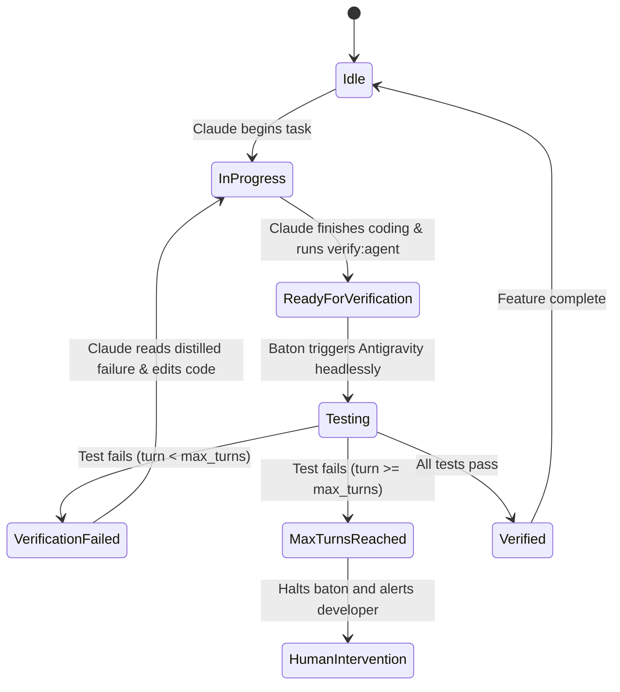

# Design Spec: Dual-Agent Hackathon Architecture (Claude Pro + Antigravity)

- **Date:** 2026-10-08
- **Status:** Draft / Ready for Review
- **Repository:** [`dual-yzentic-setup`](file:///mnt/LubaDub/Projects/Web/dual-yzentic-setup/dual-yzentic-setup)
- **Target Context:** 24-Hour Hackathon Rapid Prototyping & Claude Pro Token Preservation

---

## 1. Executive Summary & Objective

This specification details the architecture, file layout, and synchronization protocol for a **dual-agent pair-programming development environment**.

### Core Problem
1. **Claude Pro Rate Limits:** Claude Pro operates with a rolling 5-hour message quota. In a 24-hour hackathon, running extensive unit tests, Playwright browser runs, and parsing large terminal error outputs consumes thousands of tokens and exhausts Claude's message quota prematurely.
2. **Over-Engineering Traps:** In fast hackathons, AI models frequently over-engineer solutions—installing extraneous NPM packages and generating unnecessary boilerplate that breaks builds.
3. **Demo & Visual Stakes:** Hackathons are won during judging on visual polish, coherent seed data, and a compelling 3-minute pitch.

### Solution
- **Claude Code (The Builder):** Dedicated strictly to planning, UX architecture, and source code implementation. Instructed *never* to run raw test runners directly.
- **Antigravity (The Gatekeeper):** Dedicated to headless test authoring, test execution (Vitest, Playwright, Pytest), and error distillation. Antigravity absorbs all verbose terminal traces and browser DOM snapshots, returning only a 5-10 line root-cause diagnostic.
- **Lightweight Baton Runner (`scripts/baton.ts`):** A repo-native Node.js script that mediates state transitions and headless handoffs via `.agents/sync/` without background daemon overhead.
- **Curated Hackathon Skill Arsenal:** Integrated skills for token compression ([`caveman`](../../.agents/skills/caveman/SKILL.md)), minimalist code ([`ponytail`](../../.agents/skills/ponytail/SKILL.md)), elite UI/UX ([`ui-ux-pro-max`](../../.agents/skills/ui-ux-pro-max/SKILL.md), [`impeccable`](../../.agents/skills/impeccable/SKILL.md)), pitch diagrams ([`archify`](../../.agents/skills/archify/SKILL.md)), mock data ([`demo-seed-data`](../../.agents/skills/demo-seed-data/SKILL.md)), and pitch strategy ([`pitch-architect`](../../.agents/skills/pitch-architect/SKILL.md)).

---

## 2. System Architecture & Repository Layout

```text
dual-yzentic-setup/
├── .agents/
│   ├── skills/                  # Domain skills (caveman, ponytail, ui-ux-pro-max, archify, etc.)
│   └── sync/
│       ├── handoff.json         # Structured state machine state
│       └── handoff.md           # Human & agent readable diagnostic artifact
├── scripts/
│   ├── baton.ts                 # CLI baton coordinator script
│   └── run-verify.sh            # Headless execution wrapper for Antigravity
├── docs/
│   ├── ai/                      # Agent handbook & workflow documentation
│   ├── rules/                   # Frontend, backend, requirements web dev rules
│   └── specs/                   # Architectural specs & implementation plans
├── CLAUDE.md                    # Tailored behavioral rules for Claude Code (Builder role)
├── GEMINI.md                    # Tailored behavioral rules for Antigravity (QA role)
├── AGENTS.md                    # Universal tenets, safety gates, and markdown link rules
├── package.json                 # Project scripts: "verify:agent", "sync:reset", "sync:status"
├── src/                         # Application source code
└── tests/                       # Unit & integration test suites
```

---

## 3. Agent Persona Contracts

### A. Claude Code (`CLAUDE.md`) — The Builder
- **Primary Domain:** `src/`, component architecture, feature planning.
- **Directives:**
  1. **Strictly Prohibited:** Do NOT run `npm test`, `pytest`, `playwright test`, or full build commands directly.
  2. **Token Economy:** Activate [`caveman`](../../.agents/skills/caveman/SKILL.md) to strip conversational fluff. Activate [`ponytail`](../../.agents/skills/ponytail/SKILL.md) to enforce the simplest possible implementation with minimal dependencies.
  3. **Verification Interface:** When code changes are made, run:
     ```bash
     npm run verify:agent
     ```
  4. **Bug Resolution:** If `verify:agent` exits with code 1, inspect the concise failure summary printed in stdout or recorded in `.agents/sync/handoff.md`. Fix only the identified issues and re-run `npm run verify:agent`.

### B. Antigravity (`GEMINI.md`) — The Gatekeeper
- **Primary Domain:** `tests/`, test fixtures, headless browser testing, quality audit.
- **Directives:**
  1. **Log Absorption:** Executes the test suites headlessly. Traps all verbose stdout, error traces, and DOM dumps.
  2. **Distillation:** Analyzes failure traces using [`systematic-debugging`](file:///mnt/LubaDub/Projects/Web/dual-yzentic-setup/dual-yzentic-setup/.agents/skills/systematic-debugging/SKILL.md) and formats a crisp root-cause breakdown (file path, line number, expected vs. received, proposed fix vector).
  3. **Evidence Stamp:** Updates `.agents/sync/handoff.md` and sets status in `.agents/sync/handoff.json` to `verified` (exit 0) or `verification_failed` (exit 1).

---

## 4. Synchronization Protocol (`.agents/sync/`)

### State Machine Definition



### Machine State Schema (`.agents/sync/handoff.json`)
```json
{
  "version": "1.0",
  "task_id": "HACK-01",
  "active_agent": "claude",
  "status": "ready_for_verification",
  "turn_count": 1,
  "max_turns": 5,
  "last_updated": "2026-10-08T14:30:00Z",
  "summary": "Implemented user onboarding modal with Tailwind tokens",
  "files_modified": [
    "src/components/OnboardingModal.tsx",
    "src/styles/tokens.css"
  ]
}
```

### Diagnostic Report Schema (`.agents/sync/handoff.md`)
```markdown
# Agent Handoff Ticket: [TASK_ID]

- **Status:** [ready_for_verification | verification_failed | verified]
- **Active Agent:** [claude | antigravity]
- **Turn:** [current] / [max]
- **Timestamp:** YYYY-MM-DDTHH:MM:SSZ

## Changes Implemented by Claude
- [Brief bulleted summary of functional edits]
- Touched files: `src/...`

## Verification Report by Antigravity
- **Suite:** Vitest / Playwright / Pytest
- **Tests Passed:** X / Y
- **Tests Failed:** Z

### Failure Diagnostic (Only if tests failed)
- **Target File:** `path/to/file.ts:line`
- **Error:** Expected status 200, received 401
- **Root Cause:** Authorization header omitted in request options.
```

---

## 5. Token Defense & Safety Guardrails

1. **Ping-Pong Circuit Breaker:**
   `scripts/baton.ts` enforces `max_turns: 5`. If 5 consecutive test-fix iterations fail to resolve a bug, the baton aborts with an explicit prompt to the human supervisor, preventing runaway token drains.
2. **Log Truncation & Compression:**
   Antigravity isolates stderr/stdout and returns a strict maximum of 25 lines of distilled diagnostics to Claude's terminal.
3. **Non-Interactive Execution:**
   The baton invokes Antigravity using headless CLI flags (`agy --non-interactive -p "..."` or test script execution), preventing terminal hangs.
4. **Tiered Execution Lanes & Intelligent Auto-Detection:**
   To prevent wasting compute, time, and tokens on full test suite runs for minor adjustments, `scripts/baton.mjs` supports 3 operational tiers:
   - **Tier 1: Express Lane (Micro / Cosmetic / Fast-Track):**
     - *Auto-Detection:* When touched files in git diff are strictly CSS/Tailwind, markdown, static copy, or assets.
     - *Execution:* Bypasses test suites entirely. Runs an immediate diff/syntax sanity check and marks status `verified` in < 1 second.
   - **Tier 2: Scoped Lane (Component / Isolated Fix):**
     - *Auto-Detection:* When a single source file (or file + corresponding test) is modified.
     - *Execution:* Executes only the scoped test file (e.g. `tests/auth.test.ts`), skipping unrelated tests.
   - **Tier 3: Architectural Deep Lane (Full Regression):**
     - *Auto-Detection:* When database schemas, migrations, auth middleware, or > 3 core files are touched.
     - *Execution:* Runs full regression suite and build check.
   - *Manual Override:* Both agents and developers can explicitly pass flags:
     - `npm run verify:agent -- --tier 1`
     - `npm run verify:agent -- --tier 2 --scope tests/auth.test.ts`
     - `npm run verify:agent -- --tier 3`


---

## 6. Hackathon Skill Playbook

| Phase of Hackathon | Key Skills to Trigger | Expected Outcome |
| :--- | :--- | :--- |
| **Hours 0–2: Ideation & Architecture** | `superpowers:brainstorming`, [`archify`](../../.agents/skills/archify/SKILL.md) | Clarify MVP scope; generate architecture diagrams for slides early. |
| **Hours 2–18: Rapid Build Sprint** | [`ponytail`](../../.agents/skills/ponytail/SKILL.md), [`caveman`](../../.agents/skills/caveman/SKILL.md), [`ui-ux-pro-max`](../../.agents/skills/ui-ux-pro-max/SKILL.md) | Fast, minimalistic coding; zero bloated dependencies; tight token usage. |
| **Continuous: Testing & Verification** | `npm run verify:agent`, [`webapp-testing`](../../.agents/skills/webapp-testing/SKILL.md) | Antigravity runs unit & Playwright tests in background; Claude stays clean. |
| **Hours 18–21: UI Polish & Seed Data** | [`impeccable`](../../.agents/skills/impeccable/SKILL.md), [`demo-seed-data`](../../.agents/skills/demo-seed-data/SKILL.md) | Polish button contrast and typography; seed live charts, avatars, transactions. |
| **Hours 21–24: Pitch & Submission** | [`pitch-architect`](../../.agents/skills/pitch-architect/SKILL.md), [`banner-design`](../../.agents/skills/banner-design/SKILL.md), [`slides`](../../.agents/skills/slides/SKILL.md) | Generate 3-minute demo script, slide deck, and Devpost cover banner. |

---

## 7. Verification & Acceptance Criteria

The dual-agent setup is complete and verified when:
1. `.agents/sync/` directory contains initialized `handoff.json` and `handoff.md` templates.
2. `scripts/baton.ts` is implemented and executable via `npm run verify:agent`.
3. `CLAUDE.md`, `GEMINI.md`, and `AGENTS.md` are updated with the persona contracts and link formats.
4. `docs/PLAN.md` is initialized as the Universal Living Roadmap for the 2-developer team.
5. An automated test script validates:
   - Baton turn-count incrementation.
   - Circuit breaker halting at `turn_count >= 5`.
   - Correct exit codes (0 for pass, 1 for fail).
   - Markdown links integrity across the repo.

---

## 8. Two-Developer Collaboration & The Universal Living Plan (`docs/PLAN.md`)

To keep **both human developers and their AI agents synchronized** in a fast-paced 24-hour hackathon, the repository includes a single source of truth: [`docs/PLAN.md`](../PLAN.md).

### The Synchronized Team Model
- **Dev 1 (You) + Claude Code:** Primarily driving core architecture, UI, and features.
- **Dev 2 (Teammate) + AI Agent (Claude/Antigravity/Cursor):** Driving complementary endpoints, database models, integrations, or testing.

### Handling New Features & Scope Creep
When a teammate wants to add a new feature outside the original scope:
1. **Rule of the Universal Plan:** No rogue code without a ticket in [`docs/PLAN.md`](../PLAN.md). Either developer or their agent can add a proposed item to the plan.
2. **Feature Classification & Prioritization:**
   - **P0 (Must-Have for Demo):** Core user loop required for judges to understand the product.
   - **P1 (High Impact Polish):** Enhancements that elevate the demo if time permits.
   - **P2 (Post-Hackathon Stretch):** Ideas that look great but will blow the 24-hour deadline if attempted now.
3. **Owner Assignment:** Each feature explicitly declares an owner (`Owner: Dev 1` or `Owner: Dev 2`), preventing two developers from working on the same files simultaneously.

### Iterative Revision & On-Demand Skill Triggering
In a 24-hour sprint, the plan is **living and iterative**, not carved in stone:
- **Frequent Revisions are Expected:** When a feature is finished or scope pivots, check off the task in [`docs/PLAN.md`](../PLAN.md) and commit.
- **On-Demand Skill Tagging:** Every feature task in `docs/PLAN.md` can declare which skill to invoke when building it:
  ```markdown
  - [ ] **Feature: Landing Page Hero & Value Prop**
    - Owner: Dev 1
    - Priority: P0
    - Skills: `ui-ux-pro-max`, `ponytail`
    - Status: In Progress
  
  - [ ] **Feature: Interactive Architecture Diagram**
    - Owner: Dev 2
    - Priority: P1
    - Skills: `archify`
    - Status: Backlog
  ```
- **Git Sync Cadence:** Both developers pull before starting a new task and push immediately upon completing a slice (`git commit -m "feat: complete user auth (P0)"`). Because both agents inspect [`docs/PLAN.md`](../PLAN.md) and `.agents/sync/`, neither agent hallucinates obsolete requirements.

